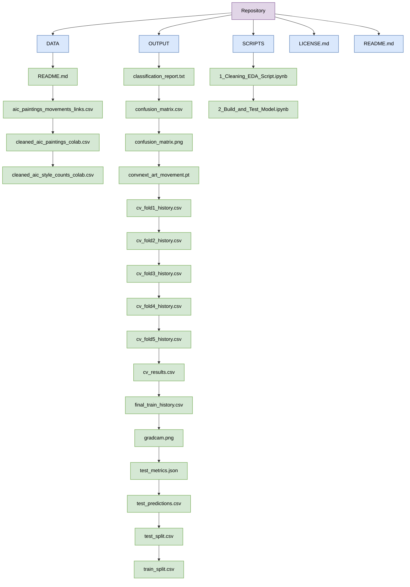

# DS4002_Project_3
## Table of Contents
1. Software and Platform  
2. Documentation Map  
3. Instructions for Reproduction
4. References

## Software and Platform
Softwares used: Google Collab and Python 3.13.15

Add-ons: pandas 2.2.3, numpy 2.1.3, matplotlib.pyplot 3.10.0, seaborn 0.13.2, scikit-learn 1.6.1, joblib 1.6.0, torch 2.11.0, torchvision 0.26.0, timm 1.0.19, requests 2.32.4, pillow 11.3.0, shutil.

Platform: Windows

## Documentation Map

## Instructions for Reproduction 
1. Download metadata scraped from the Art Institute of Chicago titled, aic_paintings_movements_links.csv and located in the DATA folder. Upload it to your Google Colab environment (or Google Drive). Note: Steps 2–5 can be accomplished by running 1_Cleaning_EDA_Script.ipynb in Google Colab.

2. Import the required libraries and load aic_paintings_movements_links.csv into a pandas DataFrame.
   
3. Clean the dataset by dropping rows missing artwork_id or title, and split semicolon separated all-styles column.

4. Create bar chart and heatmap to determine which genres heavily co-occur and require remapping. Remap and consolidate the styles into 17 standardized movement/century target categories: '14th Century (Unspecified Style)', '15th Century (Unspecified Style)', '16th Century (Unspecified Style)', '17th Century (Unspecified Style)', '18th Century (Unspecified Style)', '19th Century (Unspecified Style)', 'Baroque', 'Chinese Art', 'Folk Art', 'Impressionism', 'Japanese Art', 'Modernism', 'Neoclassicism', 'Post-Impressionism', 'Realism', 'Renaissance', 'South Asian Art'.

5. Finish EDA with cleaned data set: "cleaned_aic_paintings_colab.csv." Create new bar chart and heatmap of movement frequency and co-occurance and download cleaned csv.

6. Download 2_Build_and_Test_Model.ipynb and run within Google Colab. Note: Steps 6 - 13) can be accomplished by running 2_Build_and_Test_Model.ipynb in Google Colab). Import the required libraries and load in DATA/cleaned_aic_paintings_colab.csv into script (located in DATA folder, or locally from downloaded data).

7. Configure notebook and set hyperparameters. Download and verify missing artwork images from image_url, and transform images to reduce model overfitting.

8. Split the verified dataset into stratified training (80%, 1,246 paintings) and held-out testing (20%, 312 paintings) sets without leakage, and export train_split.csv and test_split.csv to OUTPUT.

9. Build ConvNeXt model. Customize the model with 14-class linear classification head and inverse-frequency class-weighted cross-entropy loss and report metrics.

10. Perform 5-fold stratified cross-validation on the training set and export cv_fold1_history.csv through cv_fold5_history.csv and cv_results.csv to OUTPUT.

11. Train the final model on the full training set, saving final_train_history.csv to OUTPUT.

12. Evaluate using the produced metrics and the Top-1 accuracy, Top-3 accuracy, balanced accuracy, Macro F1, and per-class precision against the 85% Top-1 finish-line target, evaluating the accuracy of the model and if project goal was achieved.

13. Export the final confusion matrix (confusion_matrix.csv, confusion_matrix.png), Grad-CAM heatmaps (gradcam.png), evaluation metrics (test_metrics.json, classification_report.txt, test_predictions.csv), and model weights (convnext_art_movement.pt) to OUTPUT folder.

## References
[1] Smarthistory, “Understanding art, an introduction.” [Online]. Available: https://smarthistory.org/introduction-to-art-historical-analysis/  
[2] “Introduction to Convolutional Neural Networks.” Geeks for Geeks. https://www.geeksforgeeks.org/machine-learning/introduction-convolution-neural-network/   
[3] Art Institute of Chicago, "Introduction," Art Institute of Chicago API Documentation. [Online]. Available: https://api.artic.edu/docs/#introduction   
