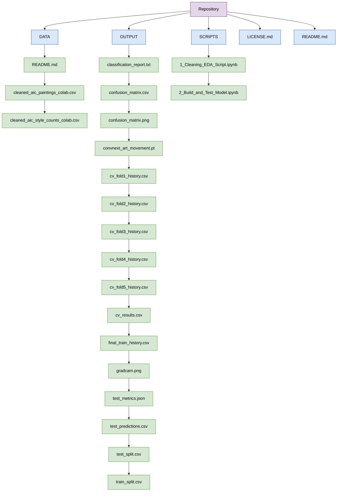

# DS4002_Project_3
## Table of Contents
1. Software and Platform  
2. Documentation Map  
3. Instructions for Reproduction  

## Software and Platform
Softwares used: Google Collab and Python 3.13.15    
Add-ons: pandas 2.2.3, numpy 2.1.3, matplotlib.pyplot 3.10.0, seaborn 0.13.2, scikit-learn 1.6.1, joblib 1.6.0    
Platform: Windows
## Documentation Map

## Instructions for Reproduction 

## References

